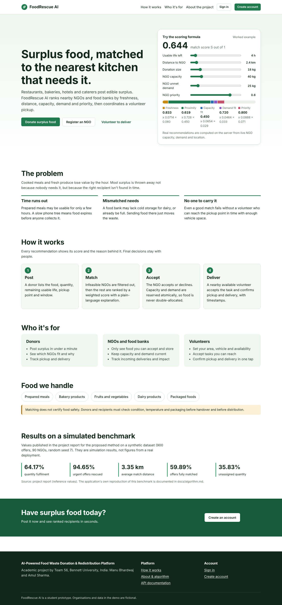
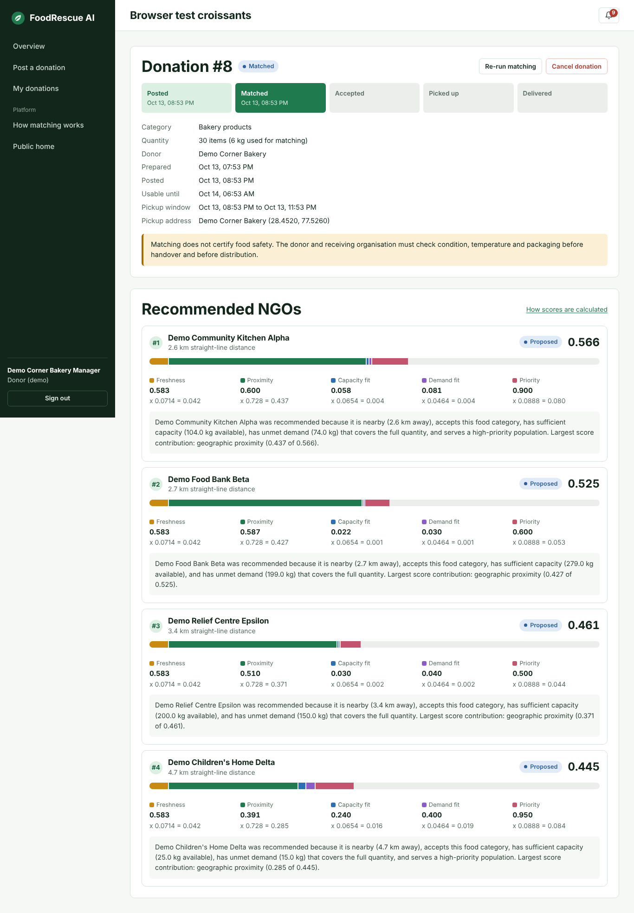
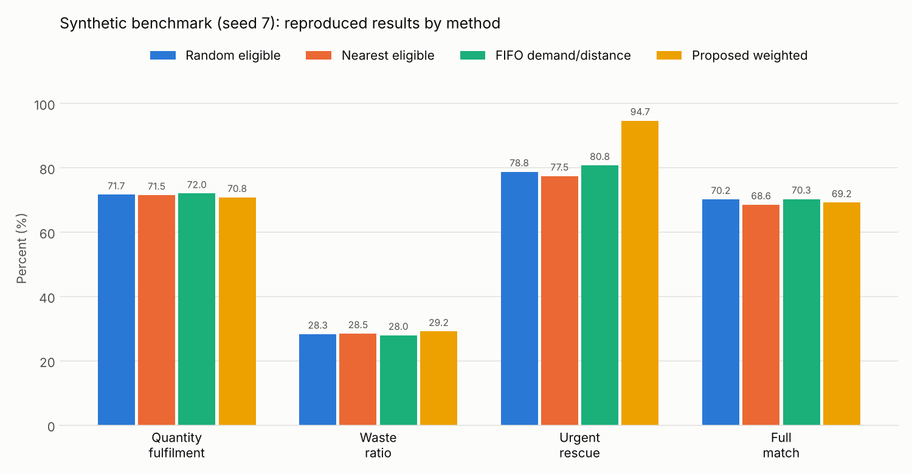

# AI-Powered Food Waste Donation & Redistribution Platform

**FoodRescue AI** — a web platform that connects surplus-food donors with NGOs and food banks,
ranks recipients with an explainable weighted scoring algorithm, and coordinates volunteer
pickups and deliveries.

Academic project · **Team 56** · Bennett University, India

| Team member | Roll No. |
|---|---|
| Manu Bhardwaj | S24BCAU0034 |
| Amul Sharma | S24BCAU0013 |



---

## Contents
1. [Problem statement](#problem-statement) · 2. [Objectives](#objectives) · 3. [Features](#main-features) ·
4. [Tech stack](#technology-stack) · 5. [Architecture](#system-architecture) · 6. [Folder structure](#folder-structure) ·
7. [Setup on Windows](#setup-on-windows) · 8. [Running tests](#running-tests) · 9. [Matching algorithm](#matching-algorithm) ·
10. [Benchmark](#synthetic-benchmark-and-results) · 11. [Limitations](#limitations-and-future-enhancements) ·
12. [Publishing to GitHub](#publishing-to-github)

## Problem statement
Restaurants, hotels, bakeries, caterers and retailers regularly have edible surplus food, while
NGOs and food banks have unmet demand. Food is wasted because perishable items expire before the
right recipient is found, because recipients may not accept a category or may lack capacity, and
because nobody is available to transport it in time.

## Objectives
- Let donors post surplus food in a minute, with quantity, remaining usable life and pickup window.
- Recommend the most suitable NGOs using urgency, distance, capacity, demand and priority — with an
  explanation for every recommendation.
- Never recommend infeasible pairs (wrong category, no capacity, no demand, expired, out of range).
- Coordinate volunteers for pickup and delivery with status tracking.
- Give administrators oversight: statistics, reports, audit logs and a reproducible evaluation.

## Main features

**What actually works in the application**

| Role | Features |
|---|---|
| Donor | Post donations (5 categories, units with kg estimate, preparation details, prep time, usable life, pickup location + window, notes, photo) · ranked NGO recommendations with all five score components and explanations · status tracking (posted → matched → accepted → picked up → delivered, cancelled, expired) · cancel · report problems |
| NGO / food bank | Register with location, priority and contact · set capacity, unmet demand and accepted categories · view recommended offers with distance, quantity and remaining life · accept / decline · track incoming and received donations · impact statistics |
| Volunteer | Set location, area, availability, vehicle capacity, travel limit, constraints · see open tasks with eligibility and straight-line distances · accept tasks · confirm pickup and delivery (timestamped) · completed-task history · link to OpenStreetMap for directions |
| Administrator | Totals (kg offered / matched / delivered), pending / delayed / expired counts, charts · all donations, NGOs, users (activate / deactivate) · matching results with components · user reports (resolve / dismiss) · audit log · run the synthetic benchmark |
| All | In-app notifications (new offers, recommendations, acceptance / rejection, volunteer assignment, pickup, delivery, expiry warnings, overdue pickups) |

**Demonstrated with synthetic data:** the benchmark comparing four allocation methods (seed 7), and
fictional demo organisations created by `python run.py seed`.

**Not included (future work):** road-network routing, SMS/email, food-safety certification,
real-world deployment data.

> Matching does **not** certify food safety. Donors and receiving organisations must check
> condition, temperature and packaging before handover and before distribution.

## Technology stack
- **Frontend:** HTML5, CSS3, vanilla JavaScript (no frameworks), responsive layout
- **Backend:** Python 3.11+, FastAPI, Pydantic, SQLAlchemy 2.0, SQLite
- **Security:** bcrypt password hashing, JWT bearer tokens (PyJWT)
- **Evaluation:** NumPy, pandas, Matplotlib
- **Testing:** pytest, FastAPI TestClient; Playwright/Chromium for the manual UI run

## System architecture
```
Browser (HTML/CSS/JS) ──fetch + JWT──► FastAPI (routes → services → matching engine)
                                         │           notifications · analytics · benchmark
                                         ▼
                                   SQLite via SQLAlchemy
```
FastAPI serves the static frontend and the API from one origin. Details, data model, state
machine, concurrency and security controls: **[docs/architecture.md](docs/architecture.md)**.

## Folder structure
```
food-waste-redistribution-platform/
├── frontend/                 # static site served by FastAPI
│   ├── index.html, about.html, login.html, register.html
│   ├── donor-dashboard.html, create-donation.html, donations.html
│   ├── ngo-dashboard.html, volunteer-dashboard.html, admin-dashboard.html, match-details.html
│   ├── css/  style.css · auth.css · dashboard.css · responsive.css
│   ├── js/   api.js · common.js · auth.js · scoring.js · dashboard.js · landing.js · about.js
│   │         donor.js · ngo.js · volunteer.js · admin.js
│   └── assets/images/  logo.svg · bell.svg
├── backend/
│   ├── app/
│   │   ├── main.py            # FastAPI app, security headers, static mounts
│   │   ├── config.py          # environment-based settings
│   │   ├── database.py        # engine, sessions, safe init
│   │   ├── models.py          # SQLAlchemy tables
│   │   ├── schemas.py         # Pydantic validation
│   │   ├── auth.py            # bcrypt, JWT, role dependencies
│   │   ├── matching.py        # weighted scoring engine (pure functions)
│   │   ├── services.py        # lifecycle, atomic acceptance, tasks, expiry
│   │   ├── serializers.py     # ORM → API responses
│   │   ├── notifications.py   # notifications + audit log
│   │   ├── analytics.py       # admin statistics
│   │   ├── benchmark.py       # synthetic dataset, 4 methods, charts
│   │   ├── seed.py            # guarded demo data
│   │   └── routes/            # auth, donation, matching, ngo, volunteer, admin, common
│   ├── tests/                 # 69 pytest tests
│   ├── pytest.ini
│   └── requirements.txt
├── data/README.md             # runtime DB, uploads, results (git-ignored)
├── docs/
│   ├── architecture.md · api-documentation.md · algorithm.md
│   ├── testing-report.md · viva-questions.md
│   ├── charts/                # benchmark charts (generated)
│   └── screenshots/
├── .env.example · .gitignore · LICENSE · README.md
└── run.py                     # init-db | seed | create-admin | benchmark | serve
```

## Setup on Windows

**Requirements:** Python 3.11 or newer ([python.org](https://www.python.org/downloads/) — tick
"Add python.exe to PATH" during install) and Git (optional, for publishing).

Open **Command Prompt** or **PowerShell** in the project folder:

```bat
:: 1. Create and activate a virtual environment
python -m venv .venv
.venv\Scripts\activate
::    (PowerShell: .venv\Scripts\Activate.ps1 — if blocked, run
::     Set-ExecutionPolicy -Scope CurrentUser RemoteSigned  once)

:: 2. Install dependencies
python -m pip install --upgrade pip
pip install -r backend\requirements.txt

:: 3. Configure environment
copy .env.example .env
python -c "import secrets; print(secrets.token_urlsafe(48))"
::    Open .env in a text editor and paste the printed value as SECRET_KEY=...

:: 4. Initialise the database (safe: never deletes data)
python run.py init-db

:: 5. (Optional) load fictional demo accounts and donations
python run.py seed

:: 6. (Optional) generate the synthetic benchmark results and charts
python run.py benchmark

:: 7. Start the application
python run.py serve
```

Open **http://127.0.0.1:8000** in your browser. Interactive API docs: **http://127.0.0.1:8000/docs**.
Stop the server with `Ctrl + C`.

macOS / Linux: identical, except `source .venv/bin/activate`, `cp .env.example .env`, and
`backend/requirements.txt` with forward slashes.

### Demo accounts
`python run.py seed` creates fictional accounts (it refuses to run if real accounts already exist
and never changes existing records). Every demo account uses the password from `DEMO_PASSWORD`
in `.env` (default **`Demo@12345`**). The login page has a "Use a demo account" helper.

| Role | Email |
|---|---|
| Admin | admin@foodrescue.example |
| Donors | donor.hotel@ · donor.bakery@ · donor.events@foodrescue.example |
| NGOs | ngo1@ … ngo6@foodrescue.example |
| Volunteers | volunteer.riya@ · volunteer.arjun@ · volunteer.meera@foodrescue.example |

The seed also drives a few donations through the real lifecycle (delivered, picked up, accepted)
so every dashboard has content. To create a real administrator instead:
`python run.py create-admin`.

## Running tests
```bat
cd backend
python -m pytest
```
Tests use a separate temporary database. Current result: **69 passed**. See
[docs/testing-report.md](docs/testing-report.md).

## Matching algorithm
Implemented in [`backend/app/matching.py`](backend/app/matching.py). It is an **explainable,
AI-assisted weighted scoring model — not a trained machine-learning model.**

1. Validate the donation (open, not expired, valid pickup window and coordinates).
2. Remove infeasible NGOs: wrong category, capacity 0 or smaller than the donation, no unmet
   demand, outside the 25 km radius, inactive, or previously declined (optionally: no reachable
   volunteer).
3. Score each remaining NGO:

| Factor | Formula | Meaning |
|---|---|---|
| Freshness urgency | `F_i = 1 − min(T_i, 24)/24` | less usable life → more urgent |
| Geographic proximity | `G_ij = exp(−D_ij/5)` | Haversine km; closer → higher |
| Capacity fit | `C_ij = min(q_i,c_j)/max(q_i,c_j)` | donation size vs available capacity |
| Demand fit | `Q_ij = min(q_i,d_j)/max(q_i,d_j)` | donation size vs unmet demand |
| Recipient priority | `P_j ∈ [0,1]` | vulnerable groups ranked higher |

4. `S_ij = 0.0714·F + 0.7280·G + 0.0654·C + 0.0464·Q + 0.0888·P` (weights from the report, sum 1).
5. Rank, keep the top 5, store each with its components and a plain-language explanation.
6. Acceptance reserves capacity and demand atomically, so no donation is allocated twice.

Zero or invalid inputs never cause division by zero or crashes. Full explanation and a worked
example: **[docs/algorithm.md](docs/algorithm.md)**.



## Synthetic benchmark and results
> **This is a synthetic benchmark, not a real-world deployment evaluation.**

`python run.py benchmark` (or the admin dashboard) regenerates a dataset with **random seed 7** —
900 offers, 90 NGOs, 5 categories, calibrated to the report's 16,915.6 kg offered, 15,191.2 kg
capacity and 12,299.1 kg demand — and compares four methods under identical rules.

| Method | Fulfilment % | Waste % | Urgent rescue % | Avg distance km | Full match % |
|---|---:|---:|---:|---:|---:|
| Random eligible | 71.66 | 28.34 | 78.81 | 9.28 | 70.22 |
| Nearest eligible | 71.53 | 28.47 | 77.48 | 3.78 | 68.56 |
| FIFO demand/distance | 72.04 | 27.96 | 80.79 | 4.19 | 70.33 |
| **Proposed weighted (calculated here)** | **70.83** | **29.17** | **94.70** | **2.40** | **69.22** |
| *Proposed — report reference value* | *64.17* | *35.83* | *94.65* | *3.35* | *59.89* |

The urgent-rescue result reproduces the report closely; fulfilment and full-match rates are higher
in our reproduction, most likely because our reconstructed demand generator differs from the
report's (explained in [docs/algorithm.md](docs/algorithm.md#how-the-reproduction-differs-from-the-report-and-why)).
The FIFO baseline rule is reconstructed from the project brief and should be checked against the
report.



## Limitations and future enhancements
**Limitations:** synthetic evaluation only; straight-line distances (no road routing); fixed,
untuned weights; whole-donation acceptance (no splitting); in-app notifications only; SQLite is
single-writer; no automated food-safety checks; README steps not executed on Windows.

**Future work:** road travel times (OSRM / maps API), splitting donations across NGOs, weight
tuning from real outcomes, SMS/WhatsApp alerts, map views, PostgreSQL, multilingual UI, pilot
with real organisations.

## Documentation
| Document | Contents |
|---|---|
| [docs/architecture.md](docs/architecture.md) | Architecture, data model, state machine, concurrency, security |
| [docs/api-documentation.md](docs/api-documentation.md) | Every endpoint (also live at `/docs`) |
| [docs/algorithm.md](docs/algorithm.md) | Formulas, worked example, benchmark method and results |
| [docs/testing-report.md](docs/testing-report.md) | Automated and browser test results |
| [docs/viva-questions.md](docs/viva-questions.md) | Viva Q&A and end-to-end workflow |

### Screenshots
`docs/screenshots/`: `landing.png`, `create-donation.png`, `match-details.png`,
`ngo-dashboard.png`, `volunteer-dashboard.png`, `mobile-ngo.png` (all with fictional demo data).

## Publishing to GitHub
1. Create an **empty** repository named `ai-powered-food-waste-redistribution-platform` on
   GitHub (no README, licence or .gitignore).
2. In the project folder:
```bat
git init
git add .
git status          :: check that .env, .venv and *.db are NOT listed
git commit -m "Initial commit: FoodRescue AI platform"
git branch -M main
git remote add origin https://github.com/<your-username>/ai-powered-food-waste-redistribution-platform.git
git push -u origin main
```

## License
[MIT](LICENSE) © 2026 Manu Bhardwaj and Amul Sharma. Check your university's rules before
publishing academic work publicly.
